# Aura Studio AI — Enterprise Jewelry Retouch & Commerce Automation

> **Live Interactive Studio Console & Capability Deck:**  
> 🔗 [https://pkoryaka.github.io/aura-studio-ai/](https://pkoryaka.github.io/aura-studio-ai/)  
> *(Test the real-time Before/After inspection slider, 9 multi-view gemological angles, brand presets, and event-driven GCP pipeline.)*

---

## Executive Overview

**Aura Studio AI** is an autonomous multimodal computer vision engine and event-driven publishing pipeline designed for high-jewelry ateliers and e-commerce enterprises. It replaces manual studio retouching (traditionally 24–48h per item at $20–$40/SKU) with **publication-ready 4K studio masters in under 35 seconds**, while preserving 100% gemological crystal lattice fidelity and automating Shopify catalog variant synchronization.

---

## Key Performance Indicators

| Metric | Traditional Workshop Pipeline | Aura Studio AI Autonomous Pipeline |
| :--- | :--- | :--- |
| **Turnaround Latency** | 24 – 48 Hours | **34.2 Seconds** |
| **Direct Cost per SKU** | $20.00 – $40.00 / item | **$2.10 / SKU** *(Google Cloud Run + Vertex AI)* |
| **Annual Savings (250 SKUs/mo)**| $75,000 – $150,000+ OPEX | **$124,800 / year saved** (-92% OPEX) |
| **Color Calibration** | Subjective operator grading | **Strict 0.00% Geometric & Spectral Lattice Clamp** |
| **Catalog Dispatch** | Manual CSV upload / media drag | **Atomic Shopify Admin GraphQL `stagedUploadsCreate`** |

---

## System Architecture

```mermaid
graph LR
    A[Raw Workshop Photography] -->|Eventarc Bucket Hook| B(Google Cloud Storage)
    B -->|FastAPI Microservice| C[Vertex AI Gemini 2.5 Vision]
    C -->|Lattice & Matrix Map| D[PyTorch GPU Worker]
    D -->|Alpha Mask + Neural Polish| E(4K Master WebP Asset)
    E -->|stagedUploadsCreate| F[Shopify Admin GraphQL API]
    F -->|Zero-Downtime Swap| G[Live Storefront Catalog]
```

### 4-Stage Processing Pipeline:
1. **Ingestion & Optical QC:** GCS Eventarc trigger validates EXIF metadata, camera sensor noise, and resolution boundaries.
2. **Gemological Vision Model:** Vertex AI Gemini 2.5 Flash Vision identifies facet geometry, inclusions, and clamps color boundaries to prevent stone hue drift.
3. **Surface Relighting & Defect Eradication:** PyTorch container running on Google Cloud Run eliminates casting porosity, dust, and workshop wax while synthesizing liquid mirror chrome and diffuse ground contact shadows.
4. **Atomic Storefront Publication:** Triggers Shopify Admin GraphQL `stagedUploadsCreate` mutation to attach the 4K master directly to live SKU variants with custom metafield audit trails (`custom.retouch_status: "Published"`).

---

## Interactive Features in Live Showcase

* **Draggable Before/After Split Inspection Slider:** 1:1 sub-pixel comparison across 3 jewelry specimens (9 camera views total).
* **Specimen Gallery:**
  1. *Art Deco Sapphire & Diamond Ring* (Platinum 950 liquid mirror chrome polish).
  2. *1930s Vintage Solitaire Diamond Ring* (Hand-carved filigree wheat pattern preservation).
  3. *4.60 Crt Natural Ethiopian Black Opal* (Spectral pinfire play-of-color retention).
* **Studio Control Plane & Brand Presets:** 1-click presets for *Cartier High-Jewelry*, *Tiffany & Co. Minimalist*, *Sotheby's Archival*, and *E-Commerce Rapid Batch*.
* **Encrypted Payload Drawer:** Live inspection of the compiled Vertex AI JSON prompt structure.
* **Interactive ROI Calculator:** Dynamic OPEX model calculating annual savings based on monthly SKU volume and current retouching costs.
* **Executive Presentation Deck:** 7-slide capability walkthrough with native full-screen mode and high-res pipeline schematics.

---

## Live Access

* **Interactive Studio Console:** [index.html](https://pkoryaka.github.io/aura-studio-ai/)
* **Executive Presentation Deck:** [deck.html](https://pkoryaka.github.io/aura-studio-ai/deck.html)

---

## Author & Contact

**Petro Koriaka**  
*AI Automation Architect & Enterprise Systems Engineer*  
Upwork: [Petro Koriaka](https://www.upwork.com/)
