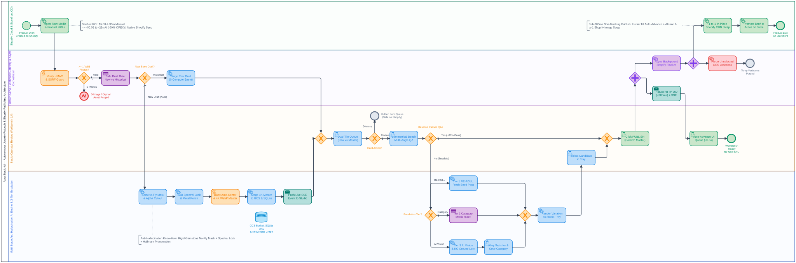
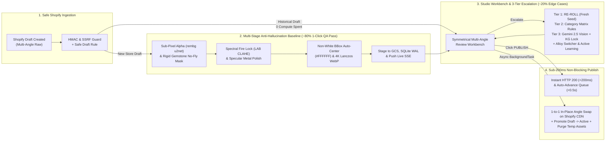

# Aura Studio AI — Enterprise Jewelry Retouch & Commerce Automation

> **Live Interactive Studio Console & Showcase:**  
> 🔗 [https://pkoryaka.github.io/aura-studio-ai/](https://pkoryaka.github.io/aura-studio-ai/)  
> *(Test the symmetrical Before/After inspection workbench, 9 multi-view gemological angles, AI Vision trait scanning, and Shopify GraphQL publishing.)*

---

## Executive Overview

**Aura Studio AI** is an autonomous multimodal computer vision engine and event-driven publishing pipeline designed for high-jewelry ateliers and luxury e-commerce enterprises. It replaces manual studio retouching (traditionally **$5.00 USD per image** and **~30 minutes per photo**) with **publication-ready 4K studio masters costing only ~$0.05 USD per image and completed within seconds**.

Additionally, native integration into the **Shopify Admin GraphQL API** eliminates the manual cycle of downloading, renaming, and uploading files, collapsing catalog-to-storefront turnaround time from days to instantaneous zero-downtime deployment.

---

## Key Performance Indicators

| Metric | Traditional Workshop Pipeline | Aura Studio AI Autonomous Pipeline |
| :--- | :--- | :--- |
| **Direct Cost per Image** | $5.00 USD / photo | **~$0.05 USD / photo** *(99% cost reduction)* |
| **Editing Latency per Image** | ~30 Minutes | **Under 25 Seconds** *(90x faster)* |
| **Catalog Turnaround (3-5 Angles/SKU)** | 2 – 4 Days (1.5 - 2.5h manual work) | **Under 2 Minutes Total** *(Instantaneous)* |
| **Annual Retouching OPEX (1,000 photos/mo)** | $60,000 / year | **$600 / year** *($59,400 net savings/yr)* |
| **Geometric & Color Fidelity** | Inconsistent manual clipping | **Sub-pixel Facet Clamping & Spectral Color Lock** |
| **Shopify Catalog Integration** | Manual file download, rename & SKU upload | **Atomic Shopify GraphQL `stagedUploadsCreate`** |

---

## Enterprise BPMN 2.0 Architecture (Aligned 100% with Production Codebase)

The diagram below models the complete 4-swimlane production lifecycle across **Shopify Cloud & Storefront CDN**, **FastAPI Server & Async Orchestrator**, **Studio Operator Review Workbench (UI)**, and the **Multi-Stage Anti-Hallucination AI Engine & 3-Tier Escalation**:

* **Download Executable Camunda 8.5 BPMN 2.0 XML:** [aura_studio_architecture.bpmn](aura_studio_architecture.bpmn)
* **High-Resolution Vector & Raster Exports:** [SVG](aura_studio_architecture_bpmn.svg) | [PNG](aura_studio_architecture_bpmn.png)

---

## Under-The-Hood Anti-Hallucination Know-How (Why This Is NOT a Single Prompt)

Potential clients should know that this system is **not a naive single-prompt wrapper** on a generic image generator. Generic prompts hallucinate catastrophically in fine jewelry: they warp facet edges, melt ring shanks, erase authentic maker hallmarks, and wash out delicate optical fire or natural matrix veins.

Aura Studio AI delivers millimeter-level geometric precision through a **multi-stage computer vision pipeline + 3-tier operator escalation architecture**:

1. **Sub-Pixel Alpha (`rembg u2net`) & Rigid Gemstone No-Fly Protection Mask:** Maps the gemstone table, facets, cabochon dome, and prongs into a locked spatial protection mask (`masking_engine.py`). Generative diffusion passes are strictly clamped outside the stone's optical interior, making it mathematically impossible to hallucinate fake facets or alter stone cut geometry.
2. **Spectral Fire Lock (`LAB CLAHE`) & Natural Matrix Preservation:** Isolates chromatic diffraction (Australian black opal play-of-color, boulder opal ironstone matrix veins, Ceylon sapphire pleochroism) in perceptual LAB color space (`pipeline_kane_engine.py`), preventing neural bleaching.
3. **Specular Metal Polish & Authentic Hallmark Protection:** Polishes oxidized silver, platinum, and 18K gold castings while strictly preserving authentic maker stamps (`PLAT 950`, `750`, `925`), vintage millgrain, and hand-carved filigree.
4. **Non-White Bounding-Box Auto-Centering (`#FFFFFF`) & 4K Lanczos WebP:** Computes the exact non-white bounding box (`RGB < 252`) and centers the piece on pure `#FFFFFF` white (`4096×4096`) with uniform luxury margins (`production_retouch_pipeline.py`).
5. **3-Tier Operator Escalation & Active Learning:** While ~80% of items pass on the automated baseline with 1 click, complex pieces escalate through **Tier 1 (`RE-ROLL`)**, **Tier 2 (`RETOUCH WITH CATEGORY`)**, or **Tier 3 (`Recognise with AI and retouch`)** — which runs a multi-angle Gemini 2.5 Vision scan grounded by the **Gemstone Knowledge Graph** (`gemstone_knowledge_graph.py`), offers a **1-Click Alloy Switcher**, and saves newly discovered configurations back into the category library.
6. **Sub-200ms Non-Blocking Publish & 1-to-1 In-Place Shopify CDN Swap:** Clicking `PUBLISH` immediately returns HTTP 200 (`<200ms`) and advances the operator UI in `<0.5s`, while an asynchronous worker performs an atomic 1-to-1 angle replacement on the Shopify CDN (preserving exact photo count and ordering with zero duplicates), promotes the product from `Draft` to `Active`, and purges unselected variations.

---

## Interactive Features in Live Showcase

* **Symmetrical Before/After Review Workbench:** 1:1 side-by-side inspection across 3 real estate jewelry specimens (9 camera angles total from public Etsy listings).
* **Multi-Angle Bar:** Instant zero-latency switching between Perspective, Side Profile, and Under-Gallery views.
* **Tier 3 Multimodal Vision Trait Scan:** Real-time gemological trait identification and micro-badge classification.
* **1-Click Alloy Quick-Switcher:** Live prompt adaptation for *Platinum*, *Sterling Silver*, *18K White Gold*, *18K Yellow Gold*, and *18K Rose Gold*.
* **Candidate Variations Gallery Tray:** History tray collecting all generated candidates for in-place comparison.
* **Active Learning Loop:** 1-click promotion of verified recipes into the permanent Category & Golden Prompt Library.
* **Atomic Shopify Publishing:** Direct simulated GraphQL dispatch to live storefront variants.

---

## Live Access & Documentation

* **Interactive Studio Console:** [https://pkoryaka.github.io/aura-studio-ai/](https://pkoryaka.github.io/aura-studio-ai/)
* **Master 1080p Video Walkthrough:** [aura_studio_production_walkthrough_hd.mp4](aura_studio_production_walkthrough_hd.mp4)
* **Production Walkthrough & Case Study:** [WALKTHROUGH.md](WALKTHROUGH.md)

---

## Author & Contact

**Petro Koriaka**  
*AI Automation Architect & Enterprise Systems Engineer*  
Upwork: [Petro Koriaka](https://www.upwork.com/)

---

## License

This project is licensed under the [MIT License](LICENSE) — intended as an open reference architecture and demonstration system for e-commerce studios.
